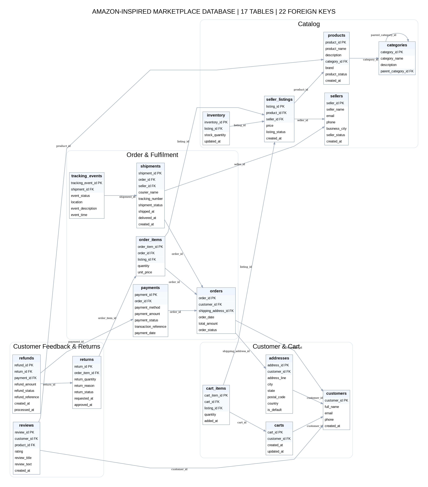

# Project Report — Amazon-Inspired E-Commerce Database Management System

**Project:** AlmaBetter Capstone Project 3  
**Database:** `amazon_capstone_project_3`  
**Technology:** PostgreSQL 17.11, pgAdmin 4, SQL  
**Project Type:** Relational Database Design, Data Integrity and Business Reporting  
**Project Date:** 22 November 2026  
**GitHub Repository:** https://github.com/hemendrakumar916-ux/amazon-ecommerce-database-capstone

---

## 1. Problem Statement & Business Context

A multi-seller e-commerce marketplace must manage large amounts of interconnected information, including customers, products, sellers, inventory, orders, payments, shipments, reviews, returns, and refunds.

Storing all this information in a single table can create several problems:

- Duplicate and inconsistent data
- Difficulty managing relationships between entities
- Inventory tracking errors
- Incorrect order and payment records
- Complicated reporting and analysis
- Data redundancy and update anomalies

### Proposed Solution

The objective of this project is to design and implement a structured relational database inspired by an Amazon-style marketplace.

The database uses PostgreSQL to store, organize, validate, and retrieve e-commerce information through relationships, constraints, and SQL queries.

**Important:** This is an educational database project using synthetic demonstration records. It does not represent Amazon's actual internal database or commercial performance.

---

## 2. Project Objectives

The primary objectives of this project are:

1. Design a normalized relational database for an e-commerce marketplace.
2. Implement relationships between customers, products, sellers, and orders.
3. Support inventory management and seller-specific product listings.
4. Manage orders, payments, shipping, returns, and refunds.
5. Implement primary keys, foreign keys, UNIQUE constraints, and CHECK constraints.
6. Apply database normalization principles.
7. Verify data integrity through SQL validation queries.
8. Generate business reports using SQL.
9. Demonstrate database backup, restore, and reproducibility.

---

## 3. Tools, Technologies & Dataset

### Technology Stack

| Technology | Purpose |
|---|---|
| PostgreSQL 17.11 | Relational database management |
| pgAdmin 4 | Database administration and SQL execution |
| SQL | Data manipulation, validation, and reporting |
| PostgreSQL pg_dump | Database backup and export |
| GitHub | Project documentation and source-code management |
| ER Diagram | Database relationship visualization |

### Dataset Description

The project contains a synthetic dataset created for database testing and demonstration.

| Metric | Verified Count |
|---|---:|
| Database Tables | 17 |
| Primary Keys | 17 |
| Foreign Keys | 22 |
| UNIQUE Constraints | 13 |
| CHECK Constraints | 20 |
| Total Demo Records | 57 |
| Customers | 3 |
| Orders | 1 |
| Sellers | 4 |
| Products | 5 |
| Shipments | 2 |
| Tracking Events | 10 |

The final database snapshot was exported on **22 November 2026 at 13:51 IST**.

The database backup was successfully restored into a separate test database named `amazon_project_3_test`.

The restored database was verified using SQL queries in pgAdmin.

---

## 4. Database Architecture & Table Design

The database consists of 17 relational tables organized into five main modules.

### 4.1 Product Catalog and Inventory Management

| Table | Purpose |
|---|---|
| categories | Stores product categories and category hierarchy |
| products | Stores product information |
| sellers | Stores seller profiles |
| seller_listings | Connects products with sellers and their offers |
| inventory | Stores stock quantities for seller listings |

### 4.2 Customer and Shopping Cart Management

| Table | Purpose |
|---|---|
| customers | Stores customer information |
| addresses | Stores customer addresses |
| carts | Stores customer shopping carts |
| cart_items | Stores products added to carts |

### 4.3 Order and Payment Management

| Table | Purpose |
|---|---|
| orders | Stores customer orders |
| order_items | Stores individual purchased items |
| payments | Stores payment records and statuses |

### 4.4 Shipment and Logistics Management

| Table | Purpose |
|---|---|
| shipments | Stores shipment information |
| tracking_events | Stores shipment tracking history |

### 4.5 Returns, Refunds and Customer Reviews

| Table | Purpose |
|---|---|
| reviews | Stores product ratings and customer feedback |
| returns | Stores product return requests |
| refunds | Stores refund records and processing statuses |

This modular design reduces unnecessary duplication and separates important business operations into logical entities.

---

## 5. Entity Relationship Diagram (ERD)

The database contains 17 tables connected through 22 foreign-key constraints.

### Database ER Diagram

The complete diagram is also available in `relationship_diagram.svg`.

### Major Database Relationships

| Parent Table | Child Table | Relationship |
|---|---|---|
| customers | addresses | One-to-Many |
| customers | orders | One-to-Many |
| orders | order_items | One-to-Many |
| orders | shipments | One-to-Many |
| shipments | tracking_events | One-to-Many |
| products | seller_listings | One-to-Many |
| sellers | seller_listings | One-to-Many |
| order_items | returns | One-to-Many |
| returns | refunds | One-to-Zero-or-One |
| categories | categories | Self-Referencing |

### Important Design Decisions

**Many-to-Many Relationship**

Products and sellers are connected through `seller_listings`.

This allows multiple sellers to offer the same product at different prices.

**Self-Referencing Relationship**

The `categories` table uses `parent_category_id` to support hierarchical category structures.

**Order Price History**

The `order_items` table stores the product price at the time of purchase, preserving transaction history when listing prices change.

**Shipment History**

The `tracking_events` table maintains chronological shipment activity.

**Return and Refund Lifecycle**

Returns and refunds are modeled separately to track their individual processing statuses.

---

## 6. Database Normalization

Database normalization is used to organize information, reduce redundancy, and minimize data anomalies.

### First Normal Form (1NF)

The database follows a design based on atomic columns and separate records.

For example, multiple products belonging to an order are stored in `order_items`, rather than being stored as a list inside the `orders` table.

### Second Normal Form (2NF)

Tables use single-column primary keys.

Seller-specific information, such as listing prices, is stored in `seller_listings` instead of directly in the `products` table.

This helps separate product identity from seller-specific offers.

### Third Normal Form (3NF)

The schema is designed to reduce unnecessary transitive dependencies.

Examples include:

- Seller information is stored in `sellers`.
- Product details are stored in `products`.
- Customer addresses are stored in `addresses`.
- Shipment history is stored in `tracking_events`.

**Normalization Limitation:** The project implements a normalized design approach, but a complete formal 3NF proof has not been performed.

Some fields, such as `orders.total_amount` and `shipments.shipment_status`, store summary or snapshot values that require synchronization with related records.

---

## 7. Database Constraints & Data Integrity

The project implements several database constraints.

### Verified Constraint Counts

| Constraint Type | Count |
|---|---:|
| PRIMARY KEY | 17 |
| FOREIGN KEY | 22 |
| UNIQUE | 13 |
| CHECK | 20 |

### Examples of Implemented Rules

- Inventory stock quantity cannot be negative.
- Order-item quantities must be positive.
- Product listing prices must be positive.
- Review ratings must be between 1 and 5.
- Return quantities must be positive.
- Duplicate seller-product listings are restricted.
- A return can have at most one directly linked refund record.
- Supported status values are validated using CHECK constraints.

### Data Integrity Limitations

Some business rules involve multiple tables and cannot be enforced using the existing declarative constraints alone.

Examples include:

- Ensuring the shipping address belongs to the ordering customer.
- Preventing combined returns from exceeding purchased quantity.
- Preventing cumulative refunds from exceeding eligible amounts.
- Ensuring refund payments belong to the correct orders.
- Synchronizing order and shipment lifecycle statuses.

These conditions were evaluated using SQL validation queries against the demonstration dataset.

---

## 8. Sample E-Commerce Transaction

The database includes a complete demonstration transaction.

### Sample Order

| Field | Value |
|---|---|
| Order ID | 1 |
| Order Status | SHIPPED |
| Number of Purchased Units | 2 |
| Total Order Value | INR 1,350 |
| Payment Method | UPI |
| Payment Status | SUCCESS |

### Seller-Wise Order Items

| Seller | Gross Order-Line Value |
|---|---:|
| TechWorld India | INR 650 |
| Smart Electronics | INR 700 |
| **Total** | **INR 1,350** |

### Shipment Information

The order is associated with two shipments:

- Shipment 1: SHIPPED
- Shipment 2: IN_TRANSIT

### Return and Refund Information

A defective keyboard return request is recorded.

- Return Quantity: 1
- Return Status: REQUESTED
- Refund Amount: INR 650
- Refund Status: PENDING

The refund has been recorded but has not yet been completed.

---

## 9. SQL Data Validation & Testing

The final database backup was restored into `amazon_project_3_test`.

All 10 SQL validation queries were successfully executed against the restored database.

### Validation Results

| Test ID | Validation Description | Verified Result |
|---|---|---|
| V01 | Order Total Amount Validation | Passed — 0 violations |
| V02 | Customer Shipping Address Validation | Passed — 0 violations |
| V03 | Shipment and Seller Relationship | Passed — 0 violations |
| V04 | Individual Return Quantity Validation | Passed — 0 violations |
| V05 | Combined Return Quantity Validation | Passed — 0 violations |
| V06 | Refund and Payment Order Relationship | Passed — 0 violations |
| V07 | Refund Amount Validation | Passed — 0 violations |
| V08 | Order and Shipment Status Validation | Passed — 0 violations |
| V09 | Latest Shipment Tracking Status Validation | Passed — 0 mismatches |
| V10 | Repeated Tracking Status Review | 5 repeated-status groups identified |

### Summary of Testing

Nine integrity checks returned zero violations.

The tenth query identified repeated shipment tracking statuses for further review.

### Repeated Tracking Events Investigation

A total of 10 tracking events were found across two shipments.

| Shipment ID | Event Status | Occurrences |
|---|---|---:|
| 1 | CREATED | 2 |
| 1 | SHIPPED | 2 |
| 2 | CREATED | 2 |
| 2 | SHIPPED | 2 |
| 2 | IN_TRANSIT | 2 |

The sample data shows tracking sequences recorded on 19 November 2026 and again on 21 November 2026.

These records have different timestamps, so they are not exact duplicate rows. However, the repeated lifecycle requires review to determine whether it represents intentional reprocessing or repeated demo-data insertion.

No tracking records were deleted during validation.

**Testing Limitation:** These checks validate the current synthetic data snapshot. They do not guarantee that future incorrect transactions will automatically be prevented.

The SQL scripts are available in `validation_queries.sql`.

---

## 10. Risks, Limitations & Improvement Opportunities

### 10.1 Cross-Table Business Rules

Some advanced consistency requirements need additional SQL triggers, application-level validation, or appropriately designed composite constraints.

### 10.2 Refund and Return Validation

The database should support additional enforcement for cumulative refunds and combined return quantities.

### 10.3 Order and Shipment Synchronization

Order statuses should remain consistent with shipment lifecycle states.

A previously identified mismatch for Order ID 1 was corrected from `PLACED` to `SHIPPED`.

The subsequent validation query returned zero mismatches.

### 10.4 Tracking History Quality

Repeated shipment status sequences were identified and documented.

For a production application, tracking history should include appropriate event validation and audit controls.

### 10.5 Dataset Size

The demonstration dataset contains only one order.

As a result, its business reports demonstrate technical functionality rather than statistically meaningful customer or sales trends.

### 10.6 Future Enhancements

Potential improvements include:

- Larger synthetic datasets
- Automated database integrity tests
- Additional SQL triggers
- Advanced sales reporting
- Indexing and query optimization
- Stored procedures
- Role-based database access
- Automated inventory alerts
- Real-time shipment tracking integration

---

## 11. Business Analysis — Verified SQL Results

Seven SQL business reporting queries were successfully executed using PostgreSQL 17 and pgAdmin 4.

The complete SQL code is available in `business_reports.sql`.

### 11.1 Order Status and Value Analysis

**Business Question:** How many orders exist for each status, and what is their recorded order value?

**Verified Result:**

| Order Status | Total Orders | Gross Order Value |
|---|---:|---:|
| SHIPPED | 1 | INR 1,350 |

**Business Insight:**

The demonstration database contains one shipped order with a recorded value of INR 1,350.

This represents gross order value, not realized profit or net revenue.

### 11.2 Seller-Wise Sales Analysis

**Business Question:** Which sellers have the highest recorded sales values?

**Verified Result:**

| Seller | Gross Sales |
|---|---:|
| Smart Electronics | INR 700 |
| TechWorld India | INR 650 |
| Digital Store | INR 0 |
| Quick Gadgets | INR 0 |
| **Total** | **INR 1,350** |

**Business Insight:**

Smart Electronics has the highest recorded gross sales of INR 700.

Two sellers have no recorded sales in the sample dataset.

SQL operations used include LEFT JOIN, SUM, COALESCE, GROUP BY, and ORDER BY.

### 11.3 Low-Stock Inventory Analysis

**Business Question:** Which seller listings have stock quantities of 20 units or fewer?

**Verified Result:**

| Product | Seller | Stock Quantity |
|---|---|---:|
| Lenovo Laptop | Digital Store | 10 |
| HP Pavilion Laptop | Smart Electronics | 12 |
| Lenovo Laptop | TechWorld India | 15 |
| Logitech K120 Keyboard | Smart Electronics | 20 |

**Business Insight:**

Four seller listings meet the selected low-stock threshold.

Digital Store's Lenovo Laptop has the lowest recorded stock of 10 units.

The threshold of 20 units is an illustrative reporting rule, not a formally established reorder point.

### 11.4 Product Ratings and Reviews Analysis

**Business Question:** How many customer reviews have products received, and what is their average rating?

**Verified Result:**

| Product | Reviews | Average Rating |
|---|---:|---:|
| Logitech K120 Keyboard | 1 | 5.00 |
| Dell KB216 Keyboard | 0 | NULL |
| HP Pavilion Laptop | 0 | NULL |
| Lenovo Laptop | 0 | NULL |
| HP K1500 Keyboard | 0 | NULL |

**Business Insight:**

Logitech K120 Keyboard has one review with an average rating of 5.00.

The other four products have no recorded reviews.

NULL indicates unavailable rating data rather than a zero-star rating.

### 11.5 Shipment Tracking Analysis

**Business Question:** What is the latest recorded tracking status and location for each shipment?

**Verified Result:**

| Shipment ID | Tracking Number | Current Status | Latest Location |
|---|---|---|---|
| 1 | DEMO-DEL-001 | SHIPPED | Delhi |
| 2 | DEMO-BD-002 | IN_TRANSIT | Delhi Hub |

**Business Insight:**

Both shipments have current statuses matching their latest recorded tracking events.

The query uses PostgreSQL LEFT JOIN LATERAL to identify the latest event for each shipment.

This prevents multiple historical tracking events from duplicating shipment summary rows.

### 11.6 Returns and Refunds Analysis

**Business Question:** What is the status of customer returns and associated refunds?

**Verified Result:**

| Field | Result |
|---|---|
| Return ID | 1 |
| Order ID | 1 |
| Return Reason | Defective keyboard |
| Return Status | REQUESTED |
| Refund Amount | INR 650 |
| Refund Status | PENDING |

**Business Insight:**

One return request is recorded for a defective keyboard.

A refund of INR 650 is associated with the request, but it remains pending.

This demonstrates how returns and refunds can be tracked through separate relational tables.

### 11.7 Category-Wise Sales Analysis

**Business Question:** Which product categories contribute to recorded gross sales?

**Verified Result:**

| Category | Units Sold | Gross Sales |
|---|---:|---:|
| Keyboards | 2 | INR 1,350 |

**Business Insight:**

All recorded purchased units in the synthetic sample belong to the Keyboards category.

Two units represent a combined gross order-line value of INR 1,350.

The query calculates sales for products directly assigned to each category and does not automatically roll results up to parent categories.

### Overall Business Reporting Findings

The database successfully demonstrates reporting across:

- Order management and financial summaries
- Seller performance
- Inventory monitoring
- Product reviews and ratings
- Logistics tracking
- Returns and refund management
- Product category reporting

SQL concepts used include JOIN, LEFT JOIN, GROUP BY, SUM, COUNT, AVG, ROUND, COALESCE, ORDER BY, WHERE, and LATERAL JOIN.

All findings represent synthetic sample data and should not be interpreted as actual Amazon business results.

---

## 12. Project Conclusion

The Amazon-Inspired E-Commerce Database Management System demonstrates the development and testing of a relational database for a multi-seller online marketplace.

### Major Project Achievements

1. Designed 17 interconnected database tables.
2. Implemented 22 foreign-key relationships.
3. Configured 17 primary keys, 13 UNIQUE constraints, and 20 CHECK constraints.
4. Organized data using relational normalization principles.
5. Created a complete database backup using PostgreSQL.
6. Successfully restored the backup into a separate test database.
7. Verified table counts, constraints, and important sample records after restoration.
8. Executed 10 database validation queries.
9. Executed seven SQL business reporting queries.
10. Documented business insights, limitations, and potential improvements.
11. Published the project source code, database backup, ERD, and documentation on GitHub.

### Final Outcome

The project demonstrates the practical use of PostgreSQL for designing relational data models, managing database constraints, validating transaction records, and generating SQL-based operational reports.

The sample workflows cover product listings, customer orders, seller transactions, payment records, shipment tracking, returns, and refunds.

The results also identify areas for future enhancement, including stronger cross-table validation, expanded datasets, and automated testing.

**Final Assessment:** The implemented database and reporting queries were successfully tested against the synthetic demonstration dataset. The project is suitable as a relational database learning and portfolio case study, subject to final verification against AlmaBetter's official submission requirements.

### GitHub Repository

https://github.com/hemendrakumar916-ux/amazon-ecommerce-database-capstone

---

*End of Project Report — AlmaBetter Capstone Project 3*
